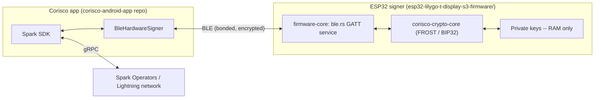

# Corisco firmware

<p align="center">
  
</p>

The firmware for Corisco, a self-custodial Lightning wallet whose keys live
on a small ESP32-S3 device instead of your phone. Every payment is
confirmed on the device's own screen, and the keys never leave it.

Built on [Spark](https://www.spark.money/)'s FROST-based threshold
signing protocol.

## Try it

You need a [LilyGo T-Display-S3](https://github.com/Xinyuan-LilyGO/T-Display-S3),
a USB data cable and [Rust](https://rustup.rs) (only to install the flashing tool).

1. Download `esp32-lilygo-t-display-s3-firmware-*.bin` (the one without `-app`) from the [latest release](https://github.com/corisco-wallet/corisco-firmware/releases/latest).
2. Plug in the device and flash it:

   ```bash
   cargo install espflash
   espflash write-bin 0x0 esp32-lilygo-t-display-s3-firmware-*.bin
   espflash reset
   ```

3. On the device, create a wallet and set a PIN. **Write down your recovery words.**
4. Install the [Corisco app](https://github.com/corisco-wallet/corisco-android-app/releases/latest) and pair with `Corisco-<id>`.

To update a device that already has a wallet, see [updating](esp32-lilygo-t-display-s3-firmware/README.md#updating).
To try a payment without real funds, see [`docs/testing.md`](docs/testing.md).

## How it works



The hard invariant: **private key material never leaves the ESP32.** The
signing logic itself lives in a separate crate,
[crypto-core](https://github.com/corisco-wallet/crypto-core), pulled in by
`firmware-core` as a dependency.

See [`docs/architecture.md`](docs/architecture.md) for the full
receive/send/sign walkthrough, request by request.

## For developers

| Path | What |
|---|---|
| `firmware-core/` | Board-agnostic firmware logic shared across ESP32/ESP-IDF boards: BLE GATT signing protocol, PIN-encrypted seed storage, RNG, Slint platform glue |
| `esp32-lilygo-t-display-s3-firmware/` | Rust firmware for the LilyGo T-Display-S3: display/touch drivers, on-device confirmation UI, boot sequence -- depends on `firmware-core` |
| `corisco-protocol/` | BLE wire protocol (postcard `Request`/`Response`, UUIDs, `PROTOCOL_VERSION`); host-buildable, no ESP deps |
| `protocol/` | `vectors.json`: golden wire vectors the mobile app is tested against |
| `docs/` | Architecture walkthrough and test-wallet notes |

Build instructions: [`esp32-lilygo-t-display-s3-firmware/README.md`](esp32-lilygo-t-display-s3-firmware/README.md#build-from-source).

## Contributing

See [`CONTRIBUTING.md`](CONTRIBUTING.md). Security-relevant reports
(anything that looks like a real vulnerability, not just a bug) should
follow this org's `SECURITY.md` instead of a public issue.

## License

Licensed under either of [Apache License, Version 2.0](LICENSE-APACHE) or
[MIT license](LICENSE-MIT) at your option.
