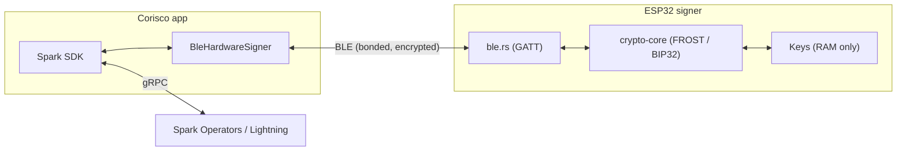

# Architecture: receiving, sending and signing

How a payment moves through the system: what the phone app does, what
crosses BLE, and what the ESP32 signer does with it. App-side paths refer
to the [corisco-android-app repo](https://github.com/corisco-wallet/corisco-android-app).

## Overview

**Private key material never leaves the ESP32.** The phone only holds
public keys and, per signing operation, a signature share it forwards to
the Spark network. Keys live in the device's RAM, unlocked from a
PIN-encrypted seed blob at boot. `BleHardwareSigner` implements the SDK's
`SparkSigner` entirely by asking the device; it has no local-key fallback.

The phone must have a bonded BLE connection (passkey shown on the device
screen) before any flow below can run.

## Receiving

Receiving needs no tap on the device. Claiming an incoming transfer is
internal protocol plumbing, not a spend.

1. The app creates an invoice through the SDK (no signer involved).
2. When a payment arrives, the app claims it. The SDK's own auto-claim is
   disabled so every claim has a known call site.
3. The claim sends the device a few internal requests: refund-transaction
   signatures (`Commit`/`Sign`), `DecryptEciesToPublicKey`, and
   `SubtractAndSplitSecretWithProofs` (the key tweak that hands the leaf to
   this wallet).

Claim signatures are sent with `requires_confirmation: false`, and the
device only skips the prompt for leaves it saw being claimed (see below).

## Sending

Every signature that can move funds needs a physical tap.

1. The user enters or scans an invoice.
2. The app pays it inside a spend context, so each `Sign` carries the
   amount and destination for the confirm screen.
3. The device receives `Sign` requests with `requires_confirmation: true`,
   one per leaf, and each one prompts. If the leaves don't match the
   invoice amount, a `SubtractSplitAndEncrypt` leaf swap comes first.

Prompting on every `Sign` in a spend is deliberate. A narrower filter was
tried and a real payment signed without the prompt appearing, so the
device asks more often rather than risk a silent spend.

**Trust model:** the amount and destination are asserted by the app. The
device only receives a sighash, so it cannot check them against what it
signs. A compromised phone could show one thing and sign another; the
hardware signer adds a second screen and a physical tap, not independent
verification.

## Confirmation gating

The device, not the app, has the final say on whether `Sign` prompts:

- The app marks real spends with `requires_confirmation: true`. It can't
  use `false` to skip a prompt on its own: the device also checks that it
  saw the leaf being claimed, and prompts otherwise.
- On-device blind signing mode (Settings) overrides both: when on, every
  `Sign` is signed without a prompt. It defaults to **on** while
  confirmation prompts are in beta, and is stored in NVS. Turn it off to
  confirm every transaction on the device.

On accept the device runs the FROST signing and returns the share. On
decline it returns an error and signs nothing.

## Requests at a glance

| Request | Confirmation |
|---|---|
| `Sign` | Prompts unless the leaf was claimed on this device and the app sent `false` (and never when blind signing is on, the default) |
| `Commit`, `GetLeafPublicKey`, `GetIdentityPublicKey`, `GetDepositPublicKey` | None (no fund-moving signature) |
| `SignSchnorrIdentity`, `SignEcdsaIdentity` | None (auth signatures, not a leaf spend) |
| `SubtractAndSplitSecretWithProofs`, `SubtractSplitAndEncrypt`, `DecryptEciesToPublicKey` | None (key plumbing; the `Sign` that follows is gated) |

Wire framing, the deferred-work design and stack-size constraints are
documented in the module comments of `firmware-core/src/ble.rs`.
